<a name="top"></a>

<div align="center">


<br/>
<br/>


<br/>
<br/>

### 본사 관리자가 전국 12개 지점의 **매출 · 메뉴 · 재고 · 발주**를<br/>하나의 SAP Fiori 화면에서 관리하는 통합 운영 시스템

<sub>SAP CODE 2기 · POU1 팀 프로젝트 · 2026.11.05 ~ 2026.11.10</sub>

<br/>

[**프로젝트 소개**](#-프로젝트-소개) &nbsp;·&nbsp;
[**미리보기**](#-미리보기) &nbsp;·&nbsp;
[**주요 기능**](#-주요-기능) &nbsp;·&nbsp;
[**화면 상세**](#-화면-상세) &nbsp;·&nbsp;
[**화면 간 연동**](#-화면-간-연동) &nbsp;·&nbsp;
[**아키텍처**](#-아키텍처) &nbsp;·&nbsp;
[**시작하기**](#-시작하기) &nbsp;·&nbsp;
[**팀원**](#-팀원-소개)

</div>

<br/>


## ☕ 프로젝트 소개

> **CafeFlow**는 SAP CODE 2기 **POU1 팀**이 **SAP Fiori(SAPUI5)** 로 만든 카페 프랜차이즈 본사용 운영 관리 웹 애플리케이션입니다.
> 흩어져 있던 지점 · 메뉴 · 매출 · 재고 · 발주 정보를 하나의 셸(Shell) 안에서 조회하고, **재고 부족 → 발주 요청 → 발주 관리**로 이어지는 업무 흐름을 화면 간 데이터 연동으로 연결했습니다.

<p align="center">
  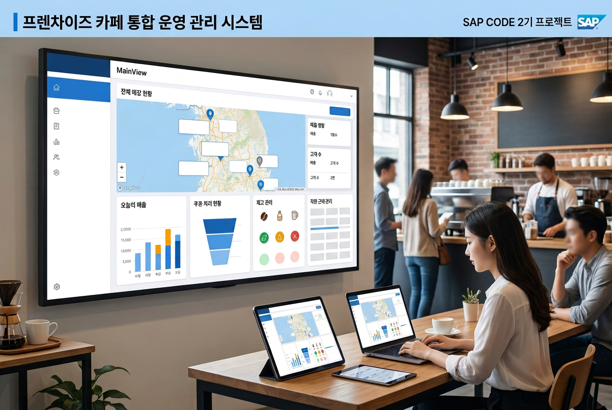
</p>

### 🎯 무엇을 해결하나요?

| 😵 이런 상황에서 | 💡 CafeFlow는 이렇게 |
| :-- | :-- |
| 지점별 매출을 따로 모아야 해서 **전체 현황 파악이 늦다** | **대시보드**에서 기간을 고르면 총매출 · 지점별 매출 · 메뉴별 판매량이 즉시 집계됩니다 |
| 어느 지점의 어떤 원재료가 **부족한지 본사가 바로 알기 어렵다** | 최소 재고 이하 품목을 **자동 추출**하고, 부족 정도를 색상으로 구분합니다 |
| 발주 요청과 발주 현황이 **따로 관리되어 누락**이 생긴다 | 재고 부족 화면에서 **원클릭 알림** → 발주 관리에 `발송 완료` 상태로 바로 연동됩니다 |
| 지점 · 메뉴 정보가 여러 곳에 **흩어져 있다** | 지점 · 메뉴 마스터를 **조건 검색 테이블**로 일원화하고, 운영 상태도 화면에서 바로 전환합니다 |

### 📊 숫자로 보는 CafeFlow

<p align="center">
  
</p>

| 항목 | 내용 |
| :-- | :-- |
| **프로젝트명** | CafeFlow — 카페 프랜차이즈 통합 운영 관리 시스템 |
| **과정 / 팀** | SAP CODE 2기 · POU1 팀 (9명) |
| **개발 기간** | 2026.11.05 ~ 2026.11.10 |
| **대상 사용자** | 프랜차이즈 본사 운영팀 · 관리자 |
| **플랫폼** | SAP Fiori 웹 앱 (Desktop · Tablet · Phone 디바이스 타입 지원) |
| **규모** | 화면 9개 · 라우트 13개 · 커밋 295개 · 머지된 PR 73건 <sub>(2026.11.10 기준)</sub> |


## 🎬 미리보기

<p align="center">
  
</p>

<p align="center"><sub>▲ 실제 앱을 실행해 캡처한 화면으로 만든 애니메이션입니다. 9개 화면이 순서대로 전환됩니다.</sub></p>


## ✨ 주요 기능

<table>
  <tr>
    <td width="33%" valign="top">
      <h3>📊 대시보드</h3>
      조회 기간을 지정하면 <b>지점별 매출(막대)</b> · <b>메뉴별 판매량(도넛)</b> 차트를 즉석에서 다시 집계합니다. 총 매출 · 운영 지점 · 인기 메뉴 · 발주 KPI 카드를 함께 보여줍니다.
    </td>
    <td width="33%" valign="top">
      <h3>🏪 지점 관리</h3>
      지점명 · 지역 · 운영 상태로 <b>복합 검색</b>합니다. 상태 버튼을 누르면 확인 팝업을 거쳐 <b>운영중 ↔ 휴점중</b>으로 전환됩니다.
    </td>
    <td width="33%" valign="top">
      <h3>📋 메뉴 관리</h3>
      메뉴명 · 카테고리 검색, 원화 통화 포맷, 판매 상태 <b>시맨틱 컬러</b>, 검색 결과에 따른 <b>총 메뉴 수</b> 자동 갱신을 제공합니다.
    </td>
  </tr>
  <tr>
    <td valign="top">
      <h3>🧾 매출 조회</h3>
      기간 · 지점 · 메뉴 조건으로 판매 내역을 조회하고 <b>총 판매량 / 총 매출금액</b>을 자동으로 합산합니다. 매출 분석에서 넘어오면 조건이 미리 채워진 채로 조회됩니다.
    </td>
    <td valign="top">
      <h3>📈 매출 분석</h3>
      <b>여러 지점을 동시에 선택</b>해 기간별 매출 차트를 비교합니다. <b>상세보기</b>를 누르면 같은 조건으로 매출 조회 화면으로 이동합니다.
    </td>
    <td valign="top">
      <h3>📦 재고 관리</h3>
      지점 · 원재료별 <b>현재 재고 / 최소 재고 / 단위</b>를 조회하고, 재고 상태를 색상 배지로 구분합니다.
    </td>
  </tr>
  <tr>
    <td valign="top">
      <h3>⚠️ 재고 부족 관리</h3>
      최소 재고 이하 품목만 <b>자동 필터링</b>하고 부족 수량을 계산합니다. 배지를 클릭하면 <b>발주 요청 알림</b>을 보낼 수 있습니다.
    </td>
    <td valign="top">
      <h3>🛒 발주 관리</h3>
      지점 · 원재료 · 발주 상태로 필터링하며, 재고 부족 화면에서 보낸 알림이 <b>알림 상태(발송 완료)</b>로 실시간 반영됩니다.
    </td>
    <td valign="top">
      <h3>🧭 공통 셸</h3>
      접이식 사이드 내비게이션, <b>실시간 시계</b>, 오늘의 <b>요약 팝업</b>, 본사관리자 <b>바로가기 메뉴</b>를 모든 화면에서 사용할 수 있습니다.
    </td>
  </tr>
</table>


## 📸 화면 상세

| # | 화면 | 라우트 (URL hash) | 주요 UI5 컨트롤 |
| :-: | :-- | :-- | :-- |
| 1 | 홈 | `#/` | `Image` · `FlexBox` |
| 2 | 대시보드 | `#/Dashboard` | `VizFrame`(column · donut) · `DatePicker` · `Panel` |
| 3 | 지점 관리 | `#/Store` · `#/StoreFilter` | `sap.ui.table.Table` · `ComboBox` · `MessageBox` |
| 4 | 메뉴 관리 | `#/Menu` | `Table` · `ObjectStatus` · `Currency` 타입 |
| 5 | 매출 조회 | `#/Sales` · `#/Sales/{Storeid}/{From}/{To}` | `Table` + 툴바 extension · `u:Currency` |
| 6 | 매출 분석 | `#/SalesAnalytics` · `#/SalesAnalyticsFilter/{Storeid}` | `MultiComboBox` · `VizFrame` |
| 7 | 재고 관리 | `#/Stock` | `Table` · `ObjectStatus` |
| 8 | 재고 부족 관리 | `#/StockShortage` | `Table`(rowsUpdated) · `MessageStrip` · `ObjectStatus`(active) |
| 9 | 발주 관리 | `#/Purchase` · `#/Purchase/{Storeid}/{Matnr}` | `Table` · 셀 내 `DatePicker` · `ObjectStatus` |

> 💡 각 항목을 펼치면 화면 캡처와 구현 포인트를 볼 수 있습니다.

<details open>
<summary><b>📊 대시보드</b> — 기간별 KPI와 지점별 / 메뉴별 차트</summary>
<br/>

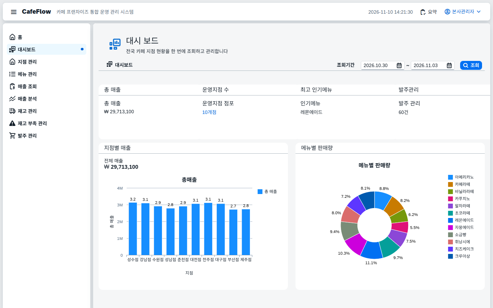

**핵심 기능**
- 조회 기간(`2026.10.30 ~ 2026.11.03` 기본값) 지정 후 **[조회]** → 판매 내역을 기간으로 거르고 **지점별 매출 · 메뉴별 판매량**을 즉석 집계
- KPI 카드 4종: **총 매출** · **운영 지점 수**(클릭 시 지점 관리로 이동) · **최고 인기 메뉴** · **발주 관리** 건수
- 막대 차트 데이터 라벨은 `formatString: "0.0,,"`으로 **백만 원 단위** 표시

**구현 포인트** — [`Dashboard.controller.js`](webapp/controller/Dashboard.controller.js)

```js
// 기간 안의 판매 내역만 골라 지점 / 메뉴 기준으로 합산 (발췌)
for (let s of sales) {
    if (s.Salesdate < start || s.Salesdate > end) { continue; }

    let b = bar.find(x => x.Storename === s.Storename),
        d = donut.find(x => x.Menuname === s.Menuname);

    if (b) { b.Salesamt += parseInt(s.Amount); }
    else   { bar.push({ Storename: s.Storename, Salesamt: parseInt(s.Amount) }); }

    if (d) { d.Soldqty += parseInt(s.Quantity); }
    else   { donut.push({ Menuname: s.Menuname, Soldqty: parseInt(s.Quantity) }); }
}
oModel.setProperty("/FilteredSalesSet", bar);    // → 지점별 매출 막대 차트
oModel.setProperty("/FilteredMenuSet", donut);   // → 메뉴별 판매량 도넛 차트
```

</details>

<details>
<summary><b>🏪 지점 관리</b> — 복합 조건 검색과 운영 상태 전환</summary>
<br/>

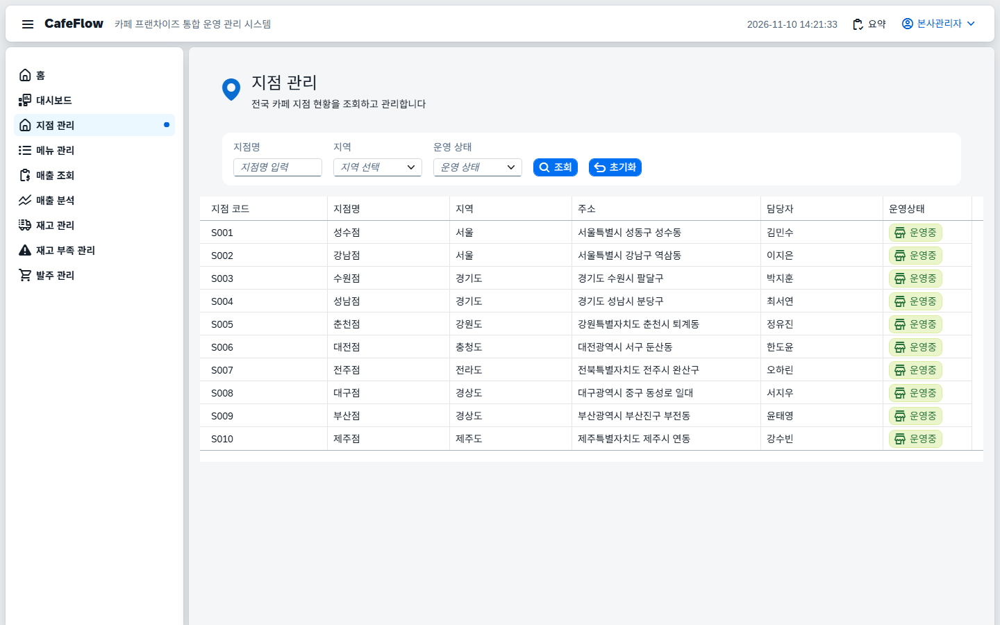

**핵심 기능**
- **지점명**(`Contains`) · **지역**(`EQ`, 7개 권역) · **운영 상태**(`EQ`) 필터를 조합해 검색, **[초기화]** 로 전체 목록 복원
- 운영 상태 컬럼은 버튼으로 표시 — 클릭 시 `MessageBox.confirm`으로 확인 후 **운영중 ↔ 휴점중** 전환
- 대시보드의 **운영 지점 수** 링크로 들어오면(`#/StoreFilter`) `운영중`이 자동 선택된 상태로 조회

**구현 포인트** — [`Store.view.xml`](webapp/view/Store.view.xml) · [`Store.controller.js`](webapp/controller/Store.controller.js)

```xml
<!-- Expression Binding: 상태 값에 따라 버튼 색(type)을 결정 -->
<Button text="{Status}"
        icon="sap-icon://retail-store"
        type="{= ${Status} === '운영중' ? 'Accept' : 'Reject' }"
        press="onStatus" />
```

```js
// 같은 뷰에 두 라우트를 연결하고, 진입 경로에 따라 초기 조건을 다르게 설정
oRoute.getRoute("Store").attachPatternMatched(this.onRouteMatch, this);
oRoute.getRoute("StoreFilter").attachPatternMatched(this.onRouteMatch, this);
```

</details>

<details>
<summary><b>📋 메뉴 관리</b> — 카테고리 검색과 판매 상태 컬러</summary>
<br/>

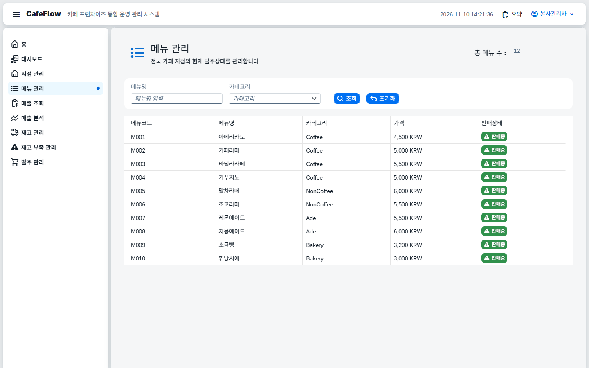

**핵심 기능**
- **메뉴명**(`Contains`) + **카테고리**(`Coffee` · `NonCoffee` · `Ade` · `Bakery` · `Dessert`) 검색
- 가격은 `sap.ui.model.type.Currency` + `KRW`로 통화 포맷 표시
- 검색 결과 건수(`binding.getLength()`)로 상단 **총 메뉴 수** 자동 갱신

**구현 포인트** — [`Menu.controller.js`](webapp/controller/Menu.controller.js)

```js
// 판매 상태 → ObjectStatus state (판매종료는 주황, 그 외는 초록)
onStatusColor: function (vStatus) {
    if (vStatus == "판매종료") return "Warning";
    else                       return "Success";
}
```

</details>

<details>
<summary><b>🧾 매출 조회</b> — 조건 조회와 합계 자동 계산</summary>
<br/>

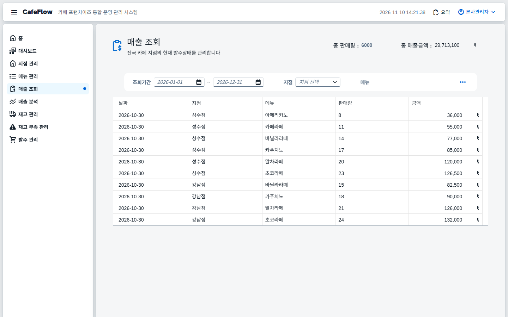

**핵심 기능**
- 테이블 툴바(extension)에 **기간 · 지점 · 메뉴** 조건 배치
- 시작일 / 종료일 입력 여부에 따라 `BT` · `GE` · `LE` 연산자를 자동 선택
- 같은 조건으로 **총 판매량 · 총 매출금액**을 다시 계산해 헤더에 표시, **[전체매출조회]** 로 즉시 전체 합계
- `#/Sales/{Storeid}/{From}/{To}` 로 진입하면 전달받은 조건을 채우고 자동 조회 (`ALL` → 조건 없음)

**구현 포인트** — [`Sales.controller.js`](webapp/controller/Sales.controller.js)

```js
// 날짜 입력 상태에 따라 필터 연산자를 다르게 생성
if (vStartDate != "" && vEndDate != "")
    oFilter = new Filter({ path: "Salesdate", operator: FilterOperator.BT, value1: vStartDate, value2: vEndDate });
else if (vStartDate != "")
    oFilter = new Filter({ path: "Salesdate", operator: FilterOperator.GE, value1: vStartDate });
else if (vEndDate != "")
    oFilter = new Filter({ path: "Salesdate", operator: FilterOperator.LE, value1: vEndDate });
```

</details>

<details>
<summary><b>📈 매출 분석</b> — 다중 지점 차트 분석과 상세보기 연동</summary>
<br/>

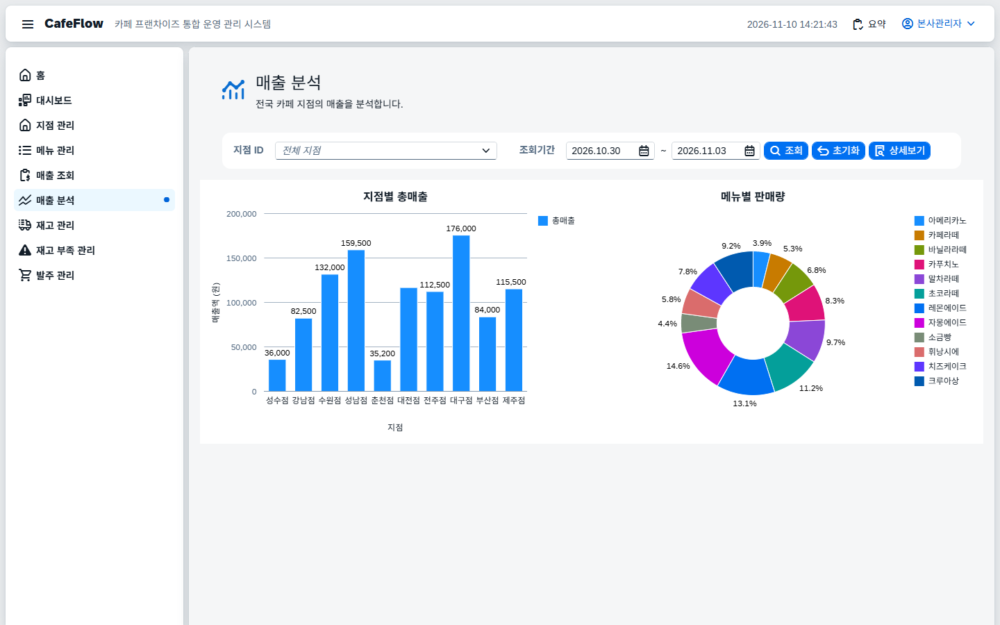

**핵심 기능**
- `MultiComboBox`로 **여러 지점 선택** + 기간 필터 → 지점별 매출(column) · 메뉴별 판매량(donut) 차트 동시 갱신
- **상세보기**: 선택한 지점 · 기간을 URL 파라미터로 넘겨 매출 조회 화면으로 이동 (지점이 2개 이상이면 `MessageToast`로 안내)
- `#/SalesAnalyticsFilter/{Storeid}` 로 특정 지점이 선택된 상태로 진입 가능

**구현 포인트** — [`SalesAnalytics.controller.js`](webapp/controller/SalesAnalytics.controller.js)

```js
// 같은 path(Storeid) 필터끼리는 OR, 다른 path(Salesdate)와는 AND로 묶임
for (let vKey of aKeys) {
    aFilter.push(new Filter({ path: "Storeid", operator: FilterOperator.EQ, value1: vKey }));
}
oStoreBinding.filter(aFilter);   // 차트 데이터셋은 "rows"가 아닌 "data" 바인딩
oMenuBinding.filter(aFilter);

// 상세보기 → 매출 조회로 조건 전달 (빈 값은 "ALL")
oRouter.navTo("SalesParam", { Storeid: vStore, From: vFrom, To: vTo });
```

</details>

<details>
<summary><b>📦 재고 관리</b> — 지점 · 원재료별 재고 현황</summary>
<br/>

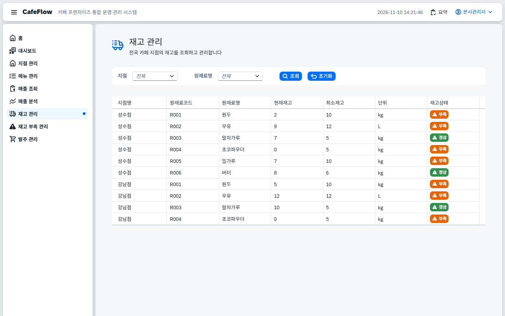

**핵심 기능**
- 지점(`StoreSet`) · 원재료(`Material.json`의 6종: 원두 · 우유 · 말차가루 · 초코파우더 · 밀가루 · 버터) 콤보박스 필터
- 현재 재고 / 최소 재고 / 단위와 **재고 상태 배지**(부족 → `Warning`, 정상 → `Success`)

</details>

<details>
<summary><b>⚠️ 재고 부족 관리</b> — 부족 품목 자동 추출과 발주 요청 알림</summary>
<br/>

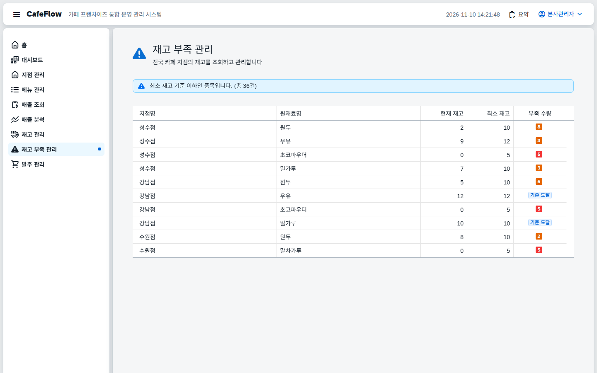

**핵심 기능**
- `onInit`에서 `Status = "부족"` 필터를 고정해 **최소 재고 이하 품목만** 표시
- `rowsUpdated` 이벤트로 `MessageStrip` 문구의 **총 건수**를 실시간 갱신
- 부족 수량 배지(`ObjectStatus active`) 클릭 → **발주 요청 알림** → 발주 관리로 이동 ([화면 간 연동](#-화면-간-연동) 참고)

**구현 포인트** — [`StockShortage.controller.js`](webapp/controller/StockShortage.controller.js)

```js
// parts 바인딩(Quantity, Minqty) + formatter로 배지 텍스트와 색을 결정
formatShortText : function (iQuantity, iMinqty) {
    if (iQuantity === iMinqty) { return "기준 도달"; }
    return iMinqty - iQuantity;                              // 부족 수량
},
formatShortState : function (iQuantity, iMinqty) {
    if (iQuantity === 0)       { return "Error"; }          // 품절   → 빨강
    if (iQuantity === iMinqty) { return "Information"; }    // 기준 도달 → 파랑
    return "Warning";                                       // 부족   → 주황
}
```

</details>

<details>
<summary><b>🛒 발주 관리</b> — 발주 상태 필터와 알림 상태 동기화</summary>
<br/>

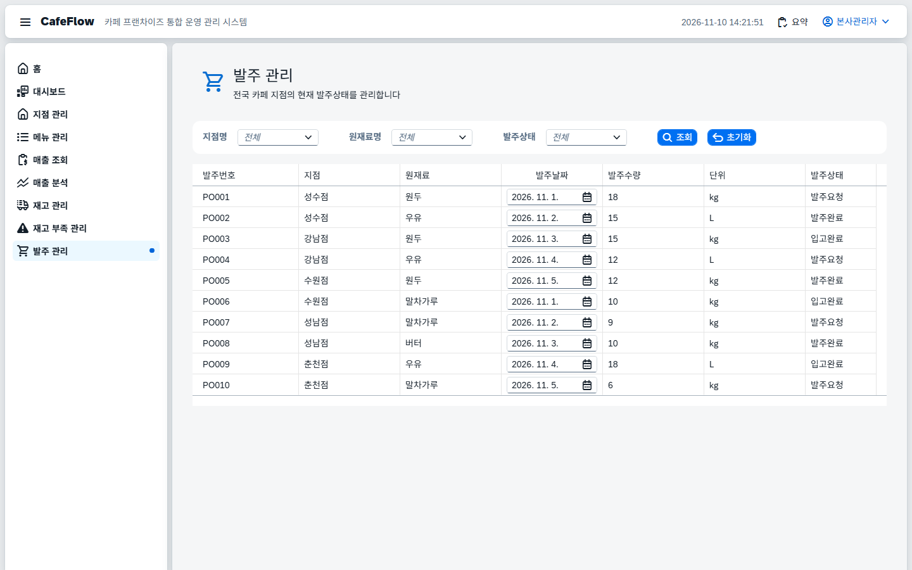

**핵심 기능**
- **지점 · 원재료 · 발주 상태**(`발주요청` · `발주완료` · `입고완료`) 필터
- 발주 날짜 셀에 `DatePicker` (`sap.ui.model.type.Date`, 원본 패턴 `yyyy-MM-dd`)
- 화면에 들어올 때마다 `onUpdateAlert()`가 재고 데이터와 비교해 **알림 상태**를 최신화

**구현 포인트** — [`Purchase.controller.js`](webapp/controller/Purchase.controller.js)

```js
// 재고 부족 화면에서 '발송 완료'된 (지점, 원재료) 쌍과 일치하는 발주 건에 알림 상태 표시
for (let ls_stock of lt_stock) {
    if (ls_purchase.Storeid == ls_stock.Storeid &&
        ls_purchase.Matnr   == ls_stock.Matnr   &&
        ls_stock.AlertStatus == "발송 완료") {
        vStatus = "발송 완료";
    }
}
oModel.setProperty("/PurchaseSet/" + i + "/AlertStatus", vStatus);
```

</details>

<details>
<summary><b>🧭 공통 셸 (App Shell)</b> — 헤더 · 사이드바 · 요약 팝업</summary>
<br/>

<p align="center">
  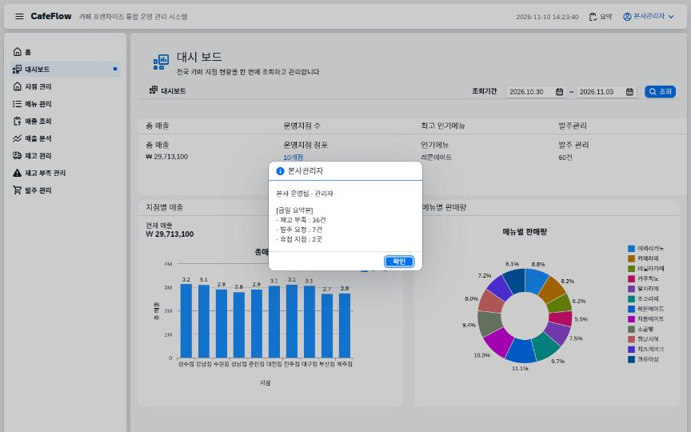
</p>

**핵심 기능**
- `sap.tnt.ToolPage` 기반 레이아웃 — `ToolHeader` + 접이식 `SideNavigation` + 화면이 교체되는 `App(navContainer)`
- 헤더 **실시간 시계**: `clock` JSONModel을 1초마다 갱신하고 `onExit`에서 `clearInterval`로 정리
- **요약** 버튼: 재고 부족 · 발주 요청 · 휴점 지점 수를 계산해 오늘의 요약을 `MessageBox`로 표시
- **본사관리자** 메뉴: 재고 부족(`{/Dashboard/ShortageCount}`건) · 발주 관리 · 지점 관리 바로가기, 로그아웃(홈) — 이동 시 사이드바 선택 상태도 함께 동기화

</details>


## 🔗 화면 간 연동

화면들은 서로 독립된 메뉴가 아니라, **URL 파라미터 라우팅**으로 업무 맥락을 이어받습니다.

<p align="center">
  
</p>

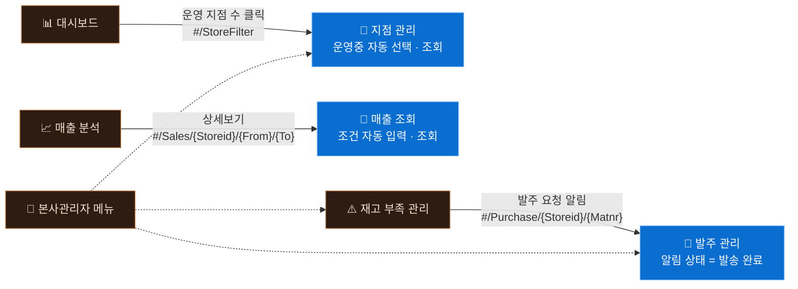

| 출발 화면 | 트리거 | 라우트 | 도착 화면에서 일어나는 일 |
| :-- | :-- | :-- | :-- |
| 📊 대시보드 | **운영 지점 수** 링크 | `StoreFilter` | 운영 상태 콤보박스에 `운영중` 자동 선택 후 조회 |
| 📈 매출 분석 | **상세보기** 버튼 | `SalesParam` | 지점 ID → 지점명 변환, 기간 · 지점 조건 자동 입력 후 조회 |
| ⚠️ 재고 부족 관리 | **부족 수량 배지** → 알림 발송 | `PurchaseParam` | `AlertStatus` 동기화 → 해당 발주 건에 `발송 완료` 배지 |
| 👤 헤더 메뉴 | 메뉴 항목 선택 | `StockShortage` · `Purchase` · `Store` | 화면 이동 + 사이드바 선택 상태 동기화 |

<details>
<summary><b>🔍 재고 부족 → 발주 연동 시퀀스 다이어그램</b></summary>
<br/>

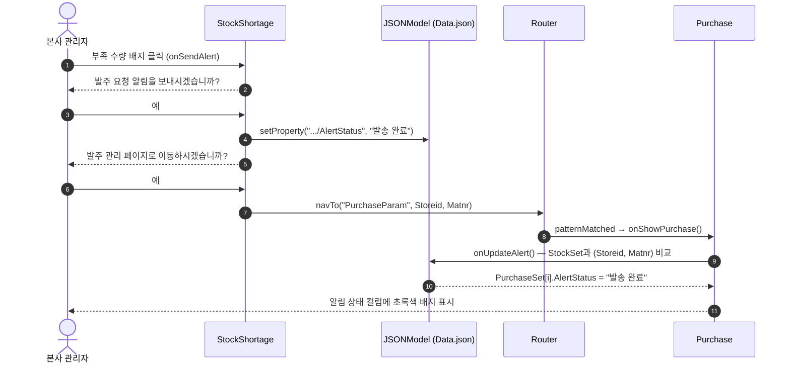

</details>


## 🧱 아키텍처

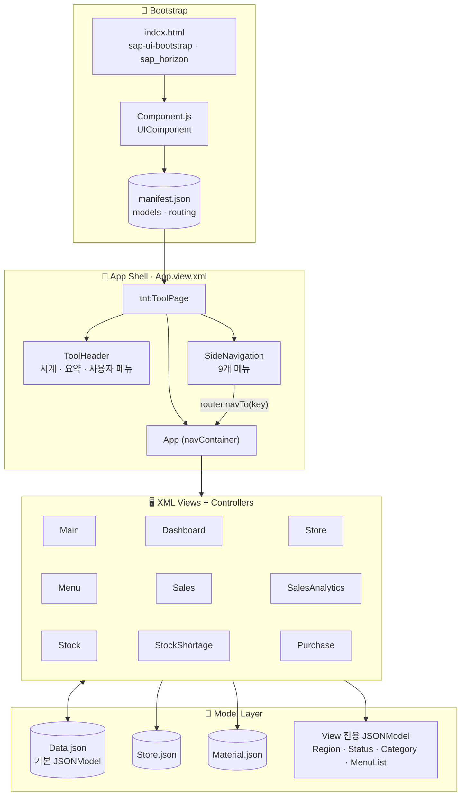

| 레이어 | 역할 |
| :-- | :-- |
| **Bootstrap** | `index.html`이 SAPUI5를 비동기 로드하고 `ComponentSupport`로 컴포넌트를 생성 |
| **Component** | `Component.js`가 Device 모델을 등록하고 `router.initialize()` 실행 |
| **Descriptor** | `manifest.json` — 기본 모델(`model/Data.json`), i18n, CSS, **라우트 13개 · 타깃 9개**, `slide` 트랜지션 |
| **Shell** | `App.view.xml`의 `ToolPage`가 헤더 · 사이드바를 고정하고, 라우터가 `navContainer`의 페이지만 교체 |
| **View / Controller** | 화면별 XML View + JS Controller (MVC), 필터는 `sap.ui.model.Filter` / `FilterOperator` |
| **Model** | 목업 JSON 데이터를 `JSONModel`로 바인딩, 콤보박스용 보조 데이터는 View 단위 Named Model로 분리 |

<details>
<summary><b>🧭 라우팅 테이블 (13개)</b></summary>
<br/>

| Route | Pattern | Target View | 비고 |
| :-- | :-- | :-- | :-- |
| `Main` | `:?query:` | Main | 기본 진입 화면 |
| `Dashboard` | `Dashboard` | Dashboard | |
| `Store` | `Store` | Store | |
| `StoreFilter` | `StoreFilter` | Store | 대시보드 → `운영중` 프리셋 |
| `Menu` | `Menu` | Menu | |
| `Sales` | `Sales` | Sales | |
| `SalesParam` | `Sales/{Storeid}/{From}/{To}` | Sales | 매출 분석 → 상세보기 |
| `SalesAnalytics` | `SalesAnalytics` | SalesAnalytics | |
| `SalesAnalyticsFilter` | `SalesAnalyticsFilter/{Storeid}` | SalesAnalytics | 지점 프리셋 |
| `Stock` | `Stock` | Stock | |
| `StockShortage` | `StockShortage` | StockShortage | |
| `Purchase` | `Purchase` | Purchase | |
| `PurchaseParam` | `Purchase/{Storeid}/{Matnr}` | Purchase | 재고 부족 → 발주 연동 |

</details>


## 💾 데이터 모델

모든 데이터는 `webapp/model/*.json` 목업 데이터이며, `manifest.json`에서 **기본(unnamed) JSONModel**로 등록됩니다.

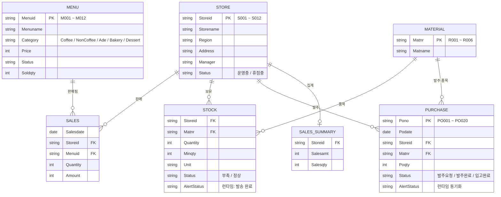

| 경로 | 건수 | 주요 필드 | 사용 화면 |
| :-- | :-: | :-- | :-- |
| `/StoreSet` | 12 | Storeid · Storename · Region · Address · Manager · Status | 지점 관리 · 재고 관리 · 요약 |
| `/MenuSet` | 12 | Menuid · Menuname · Category · Price · Status · Soldqty | 메뉴 관리 · 대시보드 |
| `/SalesSet` | 300 | Salesdate · Storeid · Menuid · Quantity · Amount | 매출 조회 · 매출 분석 · 대시보드 |
| `/SalesSummarySet` | 10 | Storeid · Storename · Salesamt · Salesqty | 대시보드 · 매출 분석 |
| `/StockSet` | 60 | Storeid · Matnr · Quantity · Minqty · Unit · Status | 재고 관리 · 재고 부족 · 발주 |
| `/PurchaseSet` | 20 | Pono · Podate · Storeid · Matnr · Poqty · Status | 발주 관리 |
| `/Dashboard` | 1 | TotalSales · StoreCount · ShortageCount | 헤더 메뉴 |
| `Material.json` | 6 | Matnr · Matname | 재고 · 발주 필터 |
| `Store.json` | 12 | Strcd · Store | 메뉴 · 매출 조회 · 발주 필터 |

<details>
<summary><b>📈 목업 데이터 인사이트 (차트)</b></summary>
<br/>

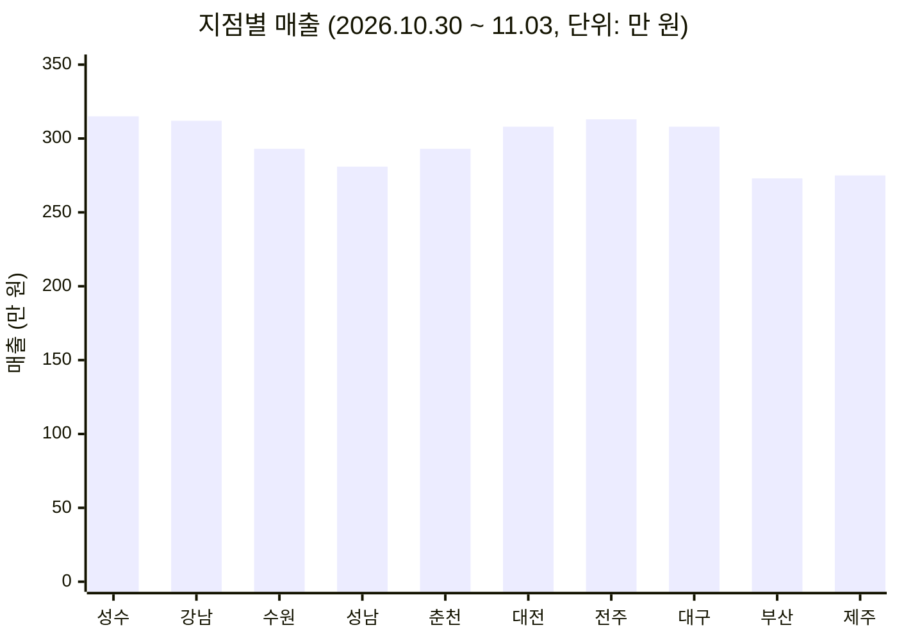

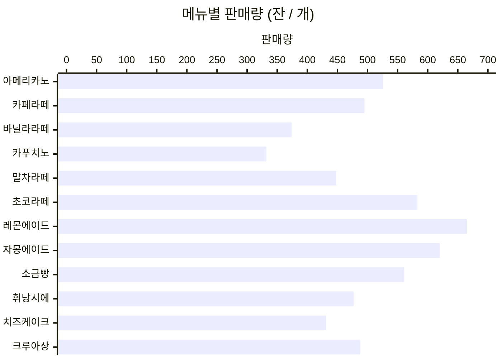

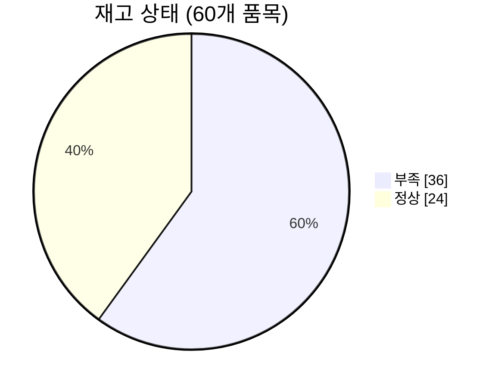

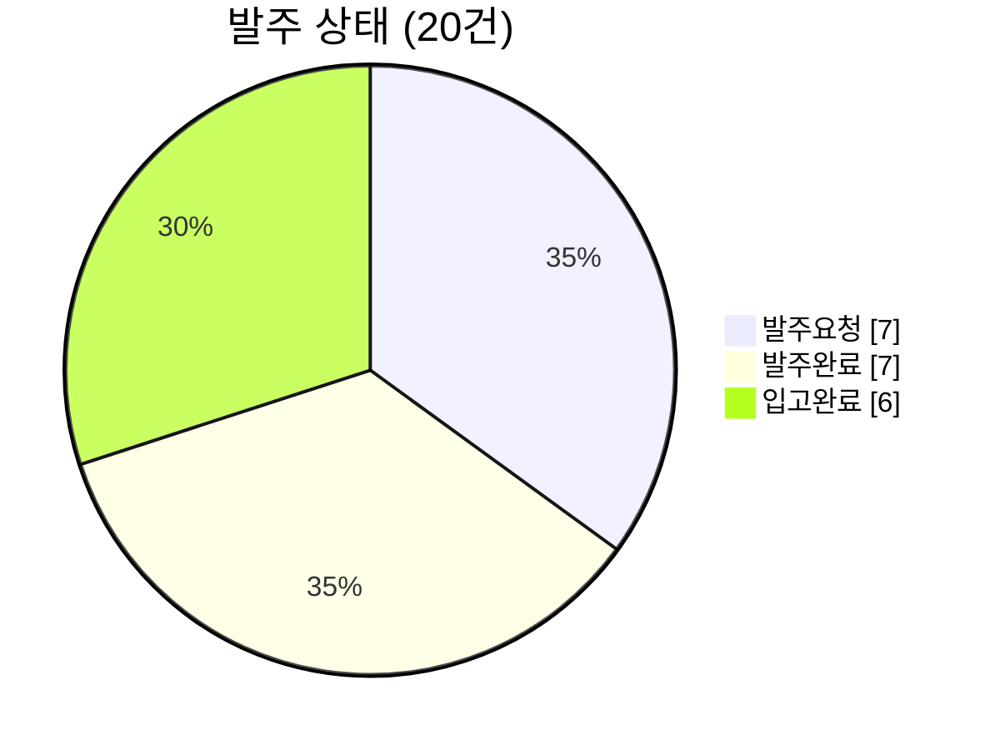

</details>

> ⚠️ 백엔드(OData) 연동 없이 클라이언트 JSONModel만 사용합니다. 운영 상태 전환 · 알림 발송 같은 변경 사항은 **브라우저 메모리에만 반영**되며 새로고침하면 초기화됩니다.


## 🧰 기술 스택

<div align="center">


</div>

| 구분 | 기술 |
| :-- | :-- |
| **Framework** | SAPUI5 **1.120.52** (SAP Fiori) |
| **UI 라이브러리** | `sap.m` · `sap.tnt`(ToolPage, SideNavigation) · `sap.ui.table` · `sap.viz`(VizFrame) · `sap.ui.unified`(Currency) |
| **아키텍처 패턴** | MVC (XML View + JS Controller), JSONModel 데이터 바인딩, Hash 기반 `sap.m.routing.Router` |
| **바인딩 기법** | Expression Binding · Composite(parts) Binding + Formatter · Named Model · Type(Currency / Date) |
| **테마** | SAP Horizon (`sap_horizon`) |
| **개발 도구** | SAP Fiori Application Generator 1.33 (Basic 템플릿) · `@sap/ux-ui5-tooling` · UI5 CLI v4 |
| **코드 품질** | ESLint 10 + `@sap-ux/eslint-plugin-fiori-tools` 권장 규칙 |
| **협업** | Git · GitHub (Issue → Branch → Pull Request) |


## 📁 프로젝트 구조

```text
SAP_POU1_Prpoject
├── webapp
│   ├── index.html                     # SAPUI5 부트스트랩 (sap_horizon · async)
│   ├── Component.js                   # UIComponent — Device 모델 · 라우터 초기화
│   ├── manifest.json                  # 앱 디스크립터 — 모델 · 라우트 13개 · 타깃 9개
│   ├── controller
│   │   ├── App.controller.js          # 셸: 사이드바 토글 · 실시간 시계 · 요약 · 사용자 메뉴
│   │   ├── Main.controller.js         # 홈
│   │   ├── Dashboard.controller.js    # KPI · 기간 집계 차트
│   │   ├── Store.controller.js        # 지점 검색 · 운영 상태 전환
│   │   ├── Menu.controller.js         # 메뉴 검색 · 판매 상태 formatter
│   │   ├── Sales.controller.js        # 매출 조건 조회 · 합계 · 파라미터 라우팅
│   │   ├── SalesAnalytics.controller.js  # 다중 지점 차트 분석 · 상세보기
│   │   ├── Stock.controller.js        # 재고 현황 필터
│   │   ├── StockShortage.controller.js   # 부족 품목 · 발주 요청 알림
│   │   └── Purchase.controller.js     # 발주 필터 · 알림 상태 동기화
│   ├── view                           # 컨트롤러와 1:1로 매칭되는 XML View 10개
│   ├── model
│   │   ├── Data.json                  # 기본 JSONModel — 지점 · 메뉴 · 매출 · 재고 · 발주 목업 데이터
│   │   ├── Store.json                 # 지점명 콤보박스 데이터
│   │   ├── Material.json              # 원재료 6종
│   │   ├── getStoreFilter.js          # 지점 필터 생성 유틸
│   │   └── models.js                  # Device 모델 팩토리
│   ├── css/style.css                  # 커스텀 스타일 (.SMALL · .MEDIUM · .LARGE 입력 폭 등)
│   ├── i18n/i18n.properties           # 다국어 리소스
│   ├── img/MainView_img.png           # 홈 화면 이미지
│   └── test                           # QUnit · OPA5 템플릿
├── docs/images                        # README 에셋 (애니메이션 SVG · 스크린샷)
├── ui5.yaml                           # Fiori tools 서버 (UI5 CDN 프록시 · 라이브 리로드 · FLP 미리보기)
├── ui5-local.yaml                     # 로컬 SAPUI5 프레임워크 실행 설정
├── eslint.config.mjs                  # ESLint 설정
└── package.json                       # 스크립트 · 개발 의존성
```


## 🚀 시작하기

<p align="center">
  
</p>

### 사전 준비

- **Node.js** `20.11` 이상 또는 `22` 이상 (UI5 CLI v4 요구 사항) · **npm** `8` 이상
- 인터넷 연결 — `npm start`는 UI5 리소스를 `https://ui5.sap.com`에서 프록시로 불러옵니다

### 설치 및 실행

```bash
git clone https://github.com/shinwokkang/SAP_POU1_Prpoject.git
```

```bash
cd SAP_POU1_Prpoject
```

```bash
npm install
```

```bash
npm start
```

브라우저에서 **Fiori Launchpad 샌드박스**(`http://localhost:8080/test/flp.html#app-preview`)가 자동으로 열립니다.
특정 화면은 해시로 바로 들어갈 수 있습니다 — 예: `http://localhost:8080/index.html#/Dashboard`

### npm 스크립트

| 명령어 | 설명 |
| :-- | :-- |
| `npm start` | Fiori tools 개발 서버 실행 후 FLP 샌드박스 열기 (라이브 리로드 포함) |
| `npm run start-local` | `ui5-local.yaml` 사용 — SAPUI5 1.120.52 프레임워크를 로컬로 받아서 실행 |
| `npm run start-noflp` | FLP 없이 `index.html` 단독 실행 (뷰 캐시 비활성화) |
| `npm run build` | `dist/` 폴더에 배포용 빌드 생성 |
| `npm run lint` | ESLint 검사 (Fiori tools 권장 규칙) |


## 🎨 UI/UX 디자인 포인트

| 포인트 | 적용 내용 |
| :-- | :-- |
| 🧩 **일관된 화면 구성** | 모든 화면을 `아이콘 + 타이틀 + 설명` → `필터 Panel` → `테이블 / 차트` 순서로 통일하고, 아이콘 · 라벨 레이아웃을 일괄 정리 |
| 🧭 **끊김 없는 내비게이션** | `ToolPage` 셸 + 접이식 사이드바, `slide` 화면 전환, 어떤 경로로 이동해도 사이드바 선택 상태가 따라감 |
| 🎨 **시맨틱 컬러** | `ObjectStatus` · `Button type`으로 상태를 색으로 전달 (아래 표) |
| 🛡️ **안전한 상태 변경** | 운영 상태 전환 · 발주 알림처럼 데이터가 바뀌는 동작은 `MessageBox.confirm`으로 한 번 더 확인 |
| ⚡ **즉각적인 피드백** | 1초마다 갱신되는 헤더 시계, 조회 즉시 바뀌는 건수 · 합계(`MessageStrip`, 총 메뉴 수, 총 판매량 / 매출금액) |
| 🔗 **맥락 유지** | 화면 이동 시 URL 파라미터로 조건을 넘겨, 도착한 화면에서 같은 조건으로 바로 조회 |
| 📱 **반응형** | `sapUiResponsiveMargin`, 화면 높이(`vh`) 기준 홈 이미지, Desktop · Tablet · Phone / Compact · Cozy 지원 |
| 📏 **입력 폭 표준화** | `style.css`의 `.SMALL`(8em) · `.MEDIUM`(14rem) · `.LARGE`(20rem) 유틸리티 클래스 |

**상태 컬러 규칙**

| 화면 | 상태 값 | 표현 |
| :-- | :-- | :-- |
| 🏪 지점 관리 | 운영중 / 휴점중 | 🟢 `Accept` 버튼 / 🔴 `Reject` 버튼 |
| 📋 메뉴 관리 | 판매중 / 판매종료 | 🟢 `Success` / 🟠 `Warning` |
| 📦 재고 관리 | 정상 / 부족 | 🟢 `Success` / 🟠 `Warning` |
| ⚠️ 재고 부족 관리 | 품절(재고 0) / 부족 / 기준 도달 | 🔴 `Error` / 🟠 `Warning` / 🔵 `Information` |
| 🛒 발주 관리 | 발송 완료 | 🟢 `Success` |


## 🤝 협업 방식

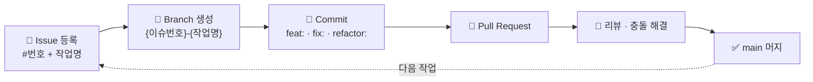

- **브랜치 규칙**: 이슈 번호로 시작하는 작업 브랜치 — 예: `20-feat-재고-부족-관리-ui-구현`, `104-매출-분석-상세보기-라우팅`
- **커밋 메시지**: `feat:` 기능 · `fix:` 수정 · `refactor:` 리팩터링 접두사 사용
- **네이밍 컨벤션**: 변수 타입을 접두사로 표기 — `o`(object) · `a`(array) · `v`(value) · `i`(integer) · `s`(string), ABAP 스타일 `lv_` · `ls_` · `lt_`

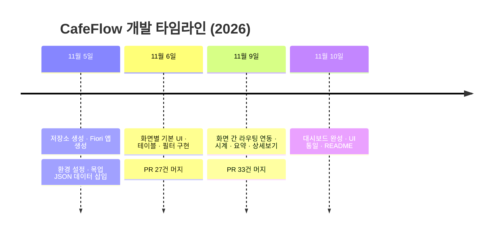


## 👥 팀원 소개

<table align="center">
  <tr>
    <td align="center" width="20%">
      <a href="https://github.com/shinwokkang"><br/><b>shinwokkang</b></a><br/>
      <sub>👑 팀장 · PM</sub><br/>
      <sub>저장소 · PR 관리<br/>UI 통일 · 요약 팝업</sub>
    </td>
    <td align="center" width="20%">
      <a href="https://github.com/baeseonghoo"><br/><b>baeseonghoo</b></a><br/>
      <sub>🧭 App Shell · 라우팅</sub><br/>
      <sub>ToolPage 레이아웃<br/>실시간 시계 · 파라미터 라우팅</sub>
    </td>
    <td align="center" width="20%">
      <a href="https://github.com/ddaruto"><br/><b>ddaruto</b></a><br/>
      <sub>📊 대시보드</sub><br/>
      <sub>KPI 카드<br/>기간 집계 차트</sub>
    </td>
    <td align="center" width="20%">
      <a href="https://github.com/soopnii"><br/><b>soopnii</b></a><br/>
      <sub>🏪 지점 관리</sub><br/>
      <sub>복합 조건 검색<br/>운영 상태 전환</sub>
    </td>
    <td align="center" width="20%">
      <a href="https://github.com/DeokB"><br/><b>DeokB</b></a><br/>
      <sub>📋 메뉴 관리</sub><br/>
      <sub>메뉴 검색<br/>판매 상태 컬러</sub>
    </td>
  </tr>
  <tr>
    <td align="center">
      <a href="https://github.com/hiiay"><br/><b>hiiay</b></a><br/>
      <sub>🧾 매출 조회</sub><br/>
      <sub>조건 조회<br/>합계 자동 계산</sub>
    </td>
    <td align="center">
      <a href="https://github.com/hakieee"><br/><b>hakieee</b></a><br/>
      <sub>📈 매출 분석</sub><br/>
      <sub>VizFrame 차트<br/>상세보기 연동</sub>
    </td>
    <td align="center">
      <a href="https://github.com/eeheaz"><br/><b>eeheaz</b></a><br/>
      <sub>📦 재고 · ⚠️ 재고 부족</sub><br/>
      <sub>재고 현황<br/>부족 알림 플로우</sub>
    </td>
    <td align="center">
      <a href="https://github.com/Moon-ivg"><br/><b>Moon-ivg</b></a><br/>
      <sub>🛒 발주 관리</sub><br/>
      <sub>발주 필터<br/>알림 상태 동기화</sub>
    </td>
    <td align="center">
      <sub>☕</sub><br/>
      <sub><b>Team POU1</b></sub><br/>
      <sub>SAP CODE 2기</sub>
    </td>
  </tr>
</table>

<p align="center">
  <a href="https://github.com/shinwokkang/SAP_POU1_Prpoject/graphs/contributors">
    
  </a>
</p>

<details>
<summary><b>📄 Application Details (SAP Fiori Application Generator)</b></summary>
<br/>

| 항목 | 값 |
| :-- | :-- |
| Generation Date and Time | Thu Nov 05 2026 09:30:34 GMT+0900 (Korean Standard Time) |
| App Generator | SAP Fiori Application Generator |
| App Generator Version | 1.33.0 |
| Generation Platform | Visual Studio Code |
| Template Used | Basic |
| Service Type | None |
| Service URL | N/A |
| Module Name | pou1_project |
| Application Title | POU1_Project |
| Namespace | code2.fiori.pou |
| UI5 Theme | sap_horizon |
| UI5 Version | 1.120.52 |
| Enable TypeScript | False |
| Add Eslint configuration | True, see [@sap-ux/eslint-plugin-fiori-tools rules](https://www.npmjs.com/package/@sap-ux/eslint-plugin-fiori-tools#rules) |

</details>

<br/>

<div align="center">


<sub>본 프로젝트는 SAP CODE 2기 교육 과정의 팀 프로젝트로 제작되었으며, 모든 데이터는 학습용 목업 데이터입니다.</sub>

<br/>

[⬆ 맨 위로](#top)

</div>
